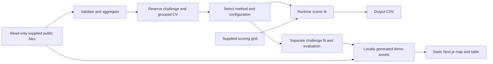

# CitySight architecture decisions

Status: PROPOSED implementation specification, reverified 2026-11-02. This file owns architecture decisions. [Contracts](02_CONTRACTS_AND_EVALUATION.md) own wire formats and evaluation rules; [phases](01_EXECUTION_SPEC.md) own execution order; [acceptance](03_ACCEPTANCE_AND_OPERATIONS.md) owns release checks. Older files link to these sources rather than define alternatives.

## Verified baseline and release objective

CitySight has a Git repository with an empty original README commit and documentation added since that commit. No application, dependency manifests, lockfiles, automated tests or infrastructure exist. These are missing implementations, not verified software defects.

Direct inspection confirms 556,561 complaints from 156 wards, 198 feature and geometry records, and 4,320 unique target keys spanning 40 disjoint wards, 18 months and six categories. The [audit report](../research/10_REVERIFICATION_REPORT.md) contains hashes, methods, source evidence and limitations.

The user selected CitySight and a hackathon demo. Deliver a reproducible offline scorer, measured ward-held-out evaluation and a locally served map with an accessible table. Public production hosting, user accounts, live municipal operations and online inference are outside this release.

## Decisions and alternatives

| ID | Final planning decision | Rationale / alternative / tradeoff |
|---|---|---|
| ADR-01 | Two local execution paths: Python scoring CLI and static frontend | Guide pp. 13–15 requires dynamic offline scoring; precomputed answer tables cannot replace it. Static demo assets remain useful for fast presentation. |
| ADR-02 | Python 3.11; standard-library ingestion, NumPy and scikit-learn for modeling | Guide manifest uses 3.11. Reuse one preprocessing/model pipeline in train, evaluate, predict and artifact export. No CatBoost/LightGBM/pandas requirement for this release. Exact compatible pins are resolved and tested in Phase 0. |
| ADR-03 | Next.js App Router, React, TypeScript, MapLibre; static export | Preserves the existing proposed frontend. No working stack is being migrated. Use local CSS and system fonts; no UI framework or animation dependency is required. Browser map initializes client-side. |
| ADR-04 | CSV/GeoJSON inputs and generated JSON; no database or web API | The dataset and offline evaluator do not require concurrent mutable storage. SQL, queues, Redis and server authentication add no demonstrated benefit here. |
| ADR-05 | Category-month mean and five-nearest-ward mean baselines; one bounded histogram boosting candidate | Simple reproducible comparisons; nearest-ward baseline reflects the guide. Candidate selected only by cross-validation WAPE and consistency, never challenge results. Defaults are defined in the contracts. |
| ADR-06 | Separate reserved challenge and development CV; separate final scorer fit | Prevents model selection from consuming the demonstration holdout. All requested scoring ward IDs are excluded from fitting if they occur in supplied labels. No hard-coded ward answers. |
| ADR-07 | COV-1 local coverage assumption with explicit limitations | Missing combinations for observed wards in the source date span count as zero records in the provided extract. Preserve partial boundary months as supplied, without extrapolation. This estimates supplied recorded counts, not verified full-month demand. Official coverage interpretation remains an external release question. |
| ADR-08 | Local static demo, neutral map style, table fallback; generated data ignored by Git | Guide forbids committed ward-month answers. Build artifacts locally after evaluation; remote basemaps, fonts, APIs and credentials are unnecessary. Static reveal offers presentation concealment only. |
| ADR-09 | Six user-controlled phases, D0–D5 | Initial handoff authorizes D0 only. A new user **continue** advances at most one phase after prerequisite gates pass. Every phase reports unresolved bugs/errors and unverified checks. |
| ADR-10 | Model/dependency versions recorded and pinned before verified release | No packages have been installed or compatibility tested by the planning agent. Never treat documentation examples or latest labels as tested pins. |

These are proposed engineering defaults for the accepted demo scope. The implementation agent may resolve reversible package patch versions in D0 and record them. Changes to release scope, metric, leakage boundaries, scorer interface or phase control require explicit user direction and a decision-record update.

## Components and ownership

All application paths below are proposed. Paths are relative to the CitySight repository root.

| Component / owner path | Responsibility | Dependencies / boundary |
|---|---|---|
| `src/citysight/data/` | CSV parsing, identifiers, counts, COV-1, geometry checks | supplied `--data-dir`; no input mutation |
| `src/citysight/features/`, `models/`, `evaluation/` | fold-safe features, baselines/candidate, splits and metrics | validated inputs; never consume challenge labels during selection |
| root `train.py`, `predict.py` | reproducible CLI adapters | same library code, runtime public data; no network |
| `src/citysight/artifacts.py` | local demo export and schema checks | recorded model/evaluation provenance; generated answers ignored by Git |
| `frontend/` | filters, details, map, table, challenge | validated versioned JSON/GeoJSON; no scoring subprocess or runtime API |
| `tests/`, `docs/implementation/` | critical tests, phase ledger and issue register | actual commands/results; never invent passed checks |

## Current risks and release boundary

P0: leakage, evaluator schema/runtime violations, malformed output or non-reproducible scoring block release. P1: complete local demo integration, accessibility, resource checks and packaging are required before declaring the demo ready. P2: further error analysis and presentation polish follow the core flow. P3: allocation, intervals, 3D, enrichment and hosting are deferred; none may silently enter a core phase.

COV-1 permits useful local development with disclosed assumptions. Unknown organizer coverage, event applicability, team token/starter availability and redistribution rights block only claims/actions that depend on them: official submission or public data publication. They do not block building a local prototype. Current guide rules prohibit original-source grievance enrichment and hidden-data probing; do neither.

There is no runtime account system or secret to design for this local static app. Public deployment would require a new scoped decision on data rights, hosting, headers/TLS, monitoring, access and budget; do not represent this demo plan as a completed production deployment plan.
