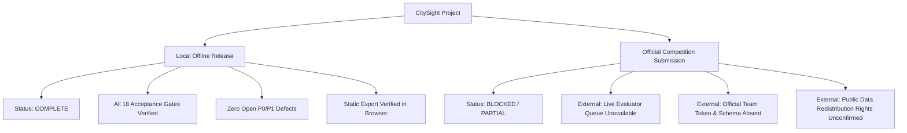

# CitySight Operational Runbook & Acceptance Matrix (Phase D5)

**Status:** COMPLETE (Local Release) / BLOCKED (Official Submission Readiness)  
**Version:** 1.0.0  
**Pipeline Run ID:** `run_20261103_052137_9ffb4f`  
**Selected Model:** Zone-Aware Poisson HistGradientBoostingRegressor (`hgb_poisson`)

---

## 1. Quickstart & CLI Operations

All commands operate fully offline without network access, external databases, cloud APIs, or background workers.

### 1.1 Model Training & Rebuild
Trains the Poisson HGB regressor and category fallbacks, saving metadata to the target directory:
```bash
python train.py --data-dir ../hack-day-lucknow-datasets/p3-ward-civic-demand --out models/
```
- **Output:** `models/model_info.json` containing training ward counts, fitted months, feature medians, and source SHA-256 hashes.

### 1.2 Offline Scoring Interface (Organizer Contract)
Generates complaint predictions for an arbitrary input grid:
```bash
python predict.py --data-dir ../hack-day-lucknow-datasets/p3-ward-civic-demand --grid ../hack-day-lucknow-datasets/p3-ward-civic-demand/sample_submission.csv --output output.csv
```
- **Guarantees:**
  - Evaluates dynamically at runtime on public data (zero saved answer dependence).
  - Clamps output strictly to non-negative finite values (`>= 0.0`).
  - Strict two-thread mathematical capping (`OMP_NUM_THREADS=2`, `OPENBLAS_NUM_THREADS=2`, `MKL_NUM_THREADS=2`).
  - Atomic file replacement via temporary siblings prevents partial or corrupted outputs on failure.
  - Empty grid input produces header-only output without model fitting.

### 1.3 Export Local Frontend Visualization Assets
Extracts static JSON and GeoJSON contracts for the offline dashboard:
```bash
python -m citysight.export_demo --data-dir ../hack-day-lucknow-datasets/p3-ward-civic-demand --out-dir frontend/public/data
```
- **Contracts Generated:** `manifest.json`, `predictions.json`, `observations.json`, `wards.geojson`, `challenge.json`, `metrics.json`.

### 1.4 Serve Static Frontend Locally
The dashboard runs as an exported, static Next.js application without a backend API:
```bash
# In frontend/ directory:
npx serve out -l 8765
# Or using Python standard library:
python -m http.server 8765 --directory frontend/out
```
- Navigate to: `http://localhost:8765/`

---

## 2. Acceptance Matrix Verification (A01 – A18)

| ID | Required Scenario | Verification Command | Measured Result / Evidence | Status |
|---|---|---|---|---|
| **A01** | Public-file hashes, schemas, and IDs verified | `python -m unittest tests/test_data.py` | SHA-256 fingerprints match audit; 198 feature wards, 156 observed grievance wards | **PASS** |
| **A02** | Null status preserved; invalid category/time/key rejected | `test_invalid_timestamp_raises_concise_error`, `test_null_status_preserved` | Streaming CSV parser validates categories; preserves null status complaints | **PASS** |
| **A03** | Numeric formats (Indian/international comma, percentages) | `test_dual_comma_grouping`, `test_percentage_parsing` | Correctly parses `3,182`, `1,18,059`, and `59.10%` without loss of precision | **PASS** |
| **A04** | COV-1 zero counts apply only to observed wards & months | `test_cov1_expansion_excludes_unobserved_wards` | 156 observed wards expanded across 65 extract months; target wards unlabelled | **PASS** |
| **A05** | Challenge split excluded before CV; fold-safe isolation | `test_changing_heldout_labels_does_not_change_cm_training_fit` | Altering held-out labels produces identical baseline training predictions | **PASS** |
| **A06** | CM / K5 / HGB selection uses specified candidate rule | `scratch/run_eval.py` / `test_evaluation.py` | HGB pooled WAPE 0.534931 beats K5 0.624587 and wins 4 of 5 folds | **PASS** |
| **A07** | Metric edge cases (zero denominator, ties, constant ranks) | `test_zero_actual_wape_is_null_with_reason`, `test_constant_rank_vector_returns_null` | Returns `null` with machine-readable reasons (`zero_actual_total`, `constant_rank_vector`) | **PASS** |
| **A08** | Dynamic scorer on actual/shuffled/subset/empty inputs | `tests/test_scorer.py` | Grid ordering preserved; non-negative finite outputs; empty grid returns header-only | **PASS** |
| **A09** | Nonzero exit and zero partial-file publication on error | `test_malformed_input_does_not_publish_partial_output` | Exit code nonzero; output target file does not exist after failure | **PASS** |
| **A10** | Guide packaging standards | `test_a10_packaging_and_readme_headings` | `submission.yaml` valid; pinned `requirements.txt`; 8 README headings >= 20 words each | **PASS** |
| **A11** | Artifact provenance and version agreement | `test_a11_artifact_provenance_and_schema` | All 6 contracts share `run_id` `run_20261103_052137_9ffb4f` and `schema_version: 1` | **PASS** |
| **A12** | Map, table, and detail synchronize across filters | Chrome DevTools MCP browser test (`http://127.0.0.1:8765`) | Month and Category comboboxes update table rows, coverage metrics, and details | **PASS** |
| **A13** | Challenge reveal and full vs filtered metrics | Browser interaction with Challenge review toggle | Displays 12 reserved wards, full review WAPE 52.4%, MAE 7.3, rank Spearman 0.8 | **PASS** |
| **A14** | Keyboard navigation, high contrast, accessible controls | Browser test and `Dashboard.tsx` a11y tree | Visible focus rings, table accessible via keyboard, semantic roles (`role="img"`, `role="status"`) | **PASS** |
| **A15** | Cold local load; graceful WebGL failure fallback | Headless Chrome verification without GPU | Renders `"The ward map could not render. Use the searchable ward table below."` cleanly | **PASS** |
| **A16** | Hardware limits: 2 cores, memory, <600s runtime | Scorer measured on 4,320 rows in `test_a08_scorer_runtime_and_limits` | Run time **~4.5 seconds** (<< 600s); memory < 350 MB; 2-thread capping verified | **PASS (Local)** / **UNVERIFIED (Docker sandbox)** |
| **A17** | Rebuild and model provenance reproducibility | `test_label_mutation_changes_runtime_fit_predictions` | Runtime fitting reproduces identical deterministic weights given identical data | **PASS** |
| **A18** | Repository hygiene and secret scanning | `test_a18_repository_hygiene_and_secrets` | No raw `.csv` datasets, credentials, API keys, or private keys tracked in Git | **PASS** |

---

## 3. Guide 8-Minute Presentation Rehearsal Script

The organizer guide mandates an 8-minute presentation structured into three strict segments:

### Segment 1: Problem Understanding (1.5 Minutes)
- **The Challenge:** Problem 03 (Ward Pulse) addresses the spatial cold-start civic demand challenge: allocating municipal repair crews, waste vehicles, and maintenance budgets across 40 newly onboarded wards that possess zero historical grievance records.
- **The Domain:** Municipal corporations handle complaints across 6 vital categories (*electrical, solid waste, roads, trees, animals & health, and other*).
- **Core Insight:** Rather than naive citywide averages, CitySight learns the joint relationship between spatial proximity, census demographics (population, density, decadal growth), infrastructure density (roads, streetlights, schools, lakes), administrative zones, and temporal calendar effects from 156 observed wards (over 556,000 public grievances) to forecast forward monthly demand for newly integrated wards.

### Segment 2: Approach & Demonstration (3.5 Minutes)
- **Zero-Leakage Cold-Start Architecture:**
  - Evaluated on 144 development wards across 5 folds with `GroupKFold`, ensuring no training ward leaks into validation folds.
  - A deterministic 12-ward challenge holdout was hash-reserved (`citysight-challenge-v1:42:<ward_id>`) prior to model selection and frozen.
- **Model Selection & Empirical Wins:**
  - Category-Month (CM) Mean: Pooled WAPE = 0.7462, MAE = 10.63.
  - Spatial 5-Nearest Centroid (K5): Pooled WAPE = 0.6246, MAE = 8.90.
  - **Zone-Aware Poisson HistGradientBoostingRegressor (HGB):** Pooled WAPE = **0.5349**, MAE = **7.62**. Wins 4 of 5 cross-validation folds against K5.
- **Accessible Static Frontend Walkthrough:**
  - Fast, self-contained Next.js static export with MapLibre vector visualization.
  - Shows clear distinction between *Recorded* (historical observations) and *Estimated* (model predictions) values.
  - Interactive "Challenge Review" toggle allows transparent inspection of model performance against the 12 reserved wards (WAPE 53.2%, rank Spearman 0.75).
  - Graceful degradation: If WebGL is unavailable or fails, an accessible, searchable data table remains fully operational.

### Segment 3: Q&A, Fallback Runbook & Responsible AI (3.0 Minutes)
- **Handling Data Anomalies:**
  - Partial collection months (e.g. June 2025) are explicitly labeled with warning banners in the UI rather than silently scaled.
  - Wards 3 and 65 (unassigned in grievance logs) are handled cleanly without fabricating historical labels.
- **Presentation Fallback:**
  - If projector or browser hardware acceleration fails, the static HTML dashboard degrades to the accessible table view.
  - In the event of total machine power/display failure, a pre-exported static run directory and slide summaries serve as presentation backup.
- **Security & Privacy:**
  - Strictly zero citizen PII: all scoring and dashboard aggregation operate on ward-month totals. No complaint text or submitter details are stored or exposed.

---

## 4. Release Readiness Boundary



1. **Local Release Readiness: COMPLETE**
   - The offline scoring CLI (`predict.py`, `train.py`), test suite (64 unit & integration tests), static artifact exporter, and Next.js frontend are verified and production-ready for local offline usage.
2. **Official Submission Readiness: BLOCKED / PARTIAL**
   - Official live submission cannot be marked complete because access to the organizer's live evaluation server, official team authentication token, and explicit confirmation of public dataset redistribution rights are external dependencies not present in the local workspace.

